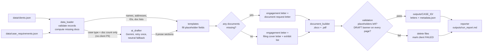
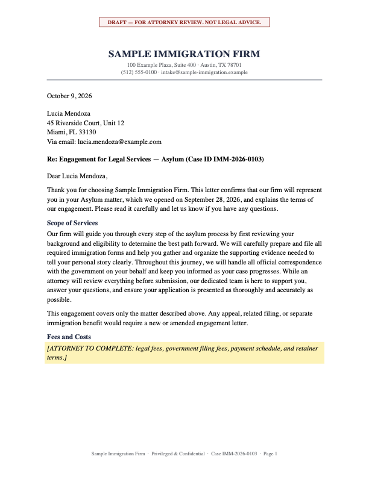
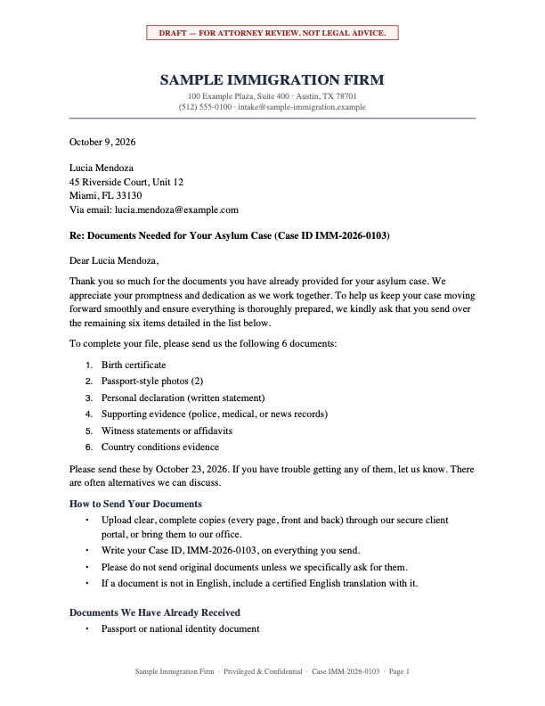
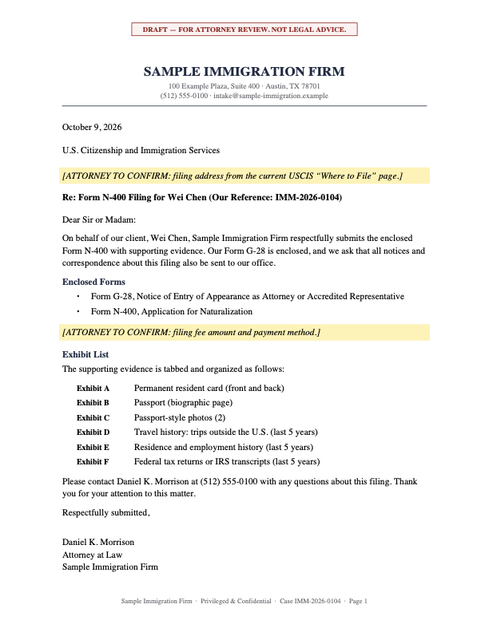

# Legal Document Generator

Turns client case data into finished, personalized letters for an immigration law firm, as Word and PDF files, with one command:

- an **engagement letter** for every client,
- then, depending on the client's documents, **either** a **document request letter** (something is missing) **or** a **filing cover letter with an exhibit list** (everything has arrived and the case is ready to file).

> **Portfolio demo.** All client data is fictional, and every generated document is stamped
> **"DRAFT — FOR ATTORNEY REVIEW. NOT LEGAL ADVICE."**

---

## The problem

At a busy immigration practice, staff open new matters every week, and almost every one needs the same letters:

- an **engagement letter** confirming representation, scope, fees and next steps,
- a **document request letter** telling the client exactly which documents are still outstanding, and
- once everything has arrived, a **filing cover letter** to the government listing the forms and every exhibit, in order.

Today that usually means opening last month's letter, retyping the client's name, address and case number, rewording the scope paragraph for the case type, and comparing the document checklist against what has arrived by hand. It's slow and repetitive. It's also where errors creep in: a previous client's name left in, a document requested that was already received, a `[CLIENT NAME]` placeholder sent out by mistake.

This tool automates the repeatable parts and leaves the judgment to the attorney:

| Done by code (exact, from data) | Done by AI (Gemini, short prose only) | Done by the attorney |
|---|---|---|
| Names, addresses, case IDs, dates | Scope-of-services paragraph for the case type | Review and approve every draft |
| Which documents are missing | Plain-language "what happens next" | Fill in fees |
| Letter layout, letterhead, signature block | Friendly intro for the document request | Decide what gets sent |
| The whole filing cover letter and exhibit list | (none: government filings stay fully predictable) | Confirm filing address and fee |

## Architecture



| Module | Responsibility |
|---|---|
| [`main.py`](main.py) | CLI, logging, per-client orchestration and error isolation, exit codes |
| [`src/data_loader.py`](src/data_loader.py) | Loads and validates JSON; `compute_document_status()` compares received vs. required |
| [`src/ai_drafter.py`](src/ai_drafter.py) | Gemini prompts, retry once, fallback text, output cleanup, stops early on a bad key or model |
| [`src/templates.py`](src/templates.py) | The three letter layouts with `{{ placeholder }}` fields, and the renderer that fills them |
| [`src/document_builder.py`](src/document_builder.py) | Writes the same letter to `.docx` (python-docx) and `.pdf` (reportlab), then validates both |
| [`src/validation.py`](src/validation.py) | Re-reads finished files: no unfilled placeholders, safety banner on every page |
| [`src/reporter.py`](src/reporter.py) | Per-client `metadata.json` and the run-level `run_report.md` |

## Setup

Requires Python 3.10+.

```bash
cd legal-document-generator
python3 -m venv .venv
source .venv/bin/activate
pip install -r requirements.txt
cp .env.example .env        # then paste your key into .env
```

Get a Gemini API key at [aistudio.google.com/apikey](https://aistudio.google.com/apikey). The key is read from `.env` (`GEMINI_API_KEY`) and is never hardcoded or logged. You can override the model with `GEMINI_MODEL` (default: `gemini-3.5-flash-lite`).

## Run

```bash
python main.py                          # every client
python main.py --client IMM-2026-0101   # one client
python main.py --offline                # no API calls; uses flagged fallback text
pytest                                  # run the test suite
```

| Exit code | Meaning |
|---|---|
| `0` | Every client succeeded (AI fallbacks are flagged in the report, not treated as failures) |
| `1` | At least one client failed; the others were still generated |
| `2` | Could not start (unreadable data file, or `--client` ID not found) |

Without a key, the run still completes: every AI section uses neutral fallback text, and each one is listed in the report for the attorney.

## Sample output

```
outputs/
├── run_report.md
├── IMM-2026-0101/              H-1B Work Visa, 5 documents missing
│   ├── engagement_letter.docx
│   ├── engagement_letter.pdf
│   ├── document_request.docx
│   ├── document_request.pdf
│   └── metadata.json
├── IMM-2026-0102/              Family-Based Green Card, 4 missing
├── IMM-2026-0103/              Asylum, 6 missing
└── IMM-2026-0104/              Naturalization, nothing missing
    ├── engagement_letter.docx
    ├── engagement_letter.pdf
    ├── filing_cover_letter.docx  (instead of a request letter; ready to file)
    ├── filing_cover_letter.pdf
    └── metadata.json
```

Console (excerpt):

```
20:30:27 INFO    [3/4] IMM-2026-0103
20:30:27 INFO        Asylum: 2 of 8 required documents received, 6 missing
20:30:28 INFO        Gemini drafted 'scope_of_services' (105 words, attempt 1)
20:30:29 INFO        Gemini drafted 'next_steps' (99 words, attempt 1)
20:30:29 INFO        Wrote and validated engagement_letter.docx and engagement_letter.pdf
20:30:29 INFO        Gemini drafted 'request_intro' (56 words, attempt 1)
20:30:29 INFO        Wrote and validated document_request.docx and document_request.pdf
20:30:29 INFO    [4/4] IMM-2026-0104
20:30:29 INFO        Naturalization: 6 of 6 required documents received, 0 missing
20:30:30 INFO        Gemini drafted 'scope_of_services' (120 words, attempt 1)
20:30:31 INFO        Gemini drafted 'next_steps' (88 words, attempt 1)
20:30:31 INFO        Wrote and validated engagement_letter.docx and engagement_letter.pdf
20:30:31 INFO        No document request needed: all 6 required documents for Naturalization have been received
20:30:31 INFO        Preparing filing cover letter with 6 exhibits
20:30:31 INFO        Wrote and validated filing_cover_letter.docx and filing_cover_letter.pdf
20:30:31 INFO    Done in 10.4s: 4 client(s), 8 letter(s), 0 failure(s), 0 AI fallback(s)
```

Generated PDFs (page 1). In the asylum client's letters, the Scope of Services, Next Steps and request intro paragraphs were written by Gemini (`gemini-3.5-flash-lite`); everything else was filled from data. The naturalization client's cover letter uses no AI at all.

| Engagement letter | Document request letter | Filing cover letter |
|---|---|---|
|  |  |  |

Excerpt from `outputs/run_report.md` (run with Gemini: 8 letters, 11 sections drafted, 0 fallbacks, 10 seconds):

| Case ID | Client | Case type | Documents generated | Missing docs | AI fallbacks | Status |
|---|---|---|---|---|---|---|
| `IMM-2026-0101` | Priya Raman | H-1B Work Visa | Engagement letter, Document request | 5 of 8 | 0 | ✅ Success |
| `IMM-2026-0104` | Wei Chen | Naturalization | Engagement letter, Filing cover letter | 0 of 6 | 0 | ✅ Success |

The report also lists every missing document per client, skipped letters and why, any AI fallbacks with the error that caused them, failures, total run time, and the log file path.

## Engineering notes

- **AI only where it adds value.** The engagement and request letters use Gemini for three short paragraphs. The filing cover letter uses none: a letter to the government should read the same every time, and its exhibit list comes straight from the documents received.
- **One source of truth per letter.** A letter is a list of typed blocks. The `.docx` and `.pdf` writers both render from it, so the two formats can't drift apart.
- **Validation runs on the finished files, not just the strings.** After writing, each `.docx` (body, header, footer) and `.pdf` (every page) is re-opened and checked. Any leftover `{{ }}` or a missing DRAFT banner deletes both files, logs an ERROR, marks the client FAILED, and makes the run exit `1`. A broken template can't quietly produce a letter.
- **AI failure policy.** Each Gemini call is retried once. If both attempts fail, neutral template text is used and flagged in the report and `metadata.json`. See *Free-tier aware* below for errors that can't recover within a run.
- **Model output is checked, not trusted.** Responses are stripped of markdown and preambles. Anything too short, or containing a bracketed placeholder like `[Client Name]`, counts as a failed attempt.
- **Per-client isolation.** A malformed record or unknown case type fails that client only; the run continues and the report says what went wrong.
- **Audit trail.** `metadata.json` records each file's timestamp, size, SHA-256, and whether each prose section came from Gemini or from fallback text.
- **Free-tier aware.** On a per-minute rate limit, the retry waits as long as the API asks (up to 60s). A daily quota, a rejected key or an unknown model can't recover within a run, so Gemini is switched off for the rest of that run instead of stalling or failing 20 more times. The default model, `gemini-3.5-flash-lite`, completes a full run within free-tier limits.
- **SDK choice.** This uses Google's current Gen AI SDK (`google-genai`). The older `google-generativeai` package reached end of life in 2025 and no longer receives updates.

## Tests

`pytest` runs 51 tests in under a second, with no network calls:

- **Missing-documents logic**: none, some, or all received; case and whitespace-insensitive matching; extra documents reported separately; duplicates; unknown case types; filing forms listed for every case type; and a check that the sample data exercises both the "request letter" and "cover letter" paths.
- **Placeholder validation**: detection (including stray braces and placeholders split across lines by PDF extraction); rendering leaves unknown fields for validation to catch; building refuses to write a letter with gaps; validators catch placeholders inside real `.docx`/`.pdf` files; safety banner on every page; unmarked PDF rejected.
- **AI drafter**: success, retry-then-success, fallback after two failures, rate-limit retry honours the API's delay, stop after a rejected key or used-up daily quota, unusable output rejected.
- **Cover letter**: exhibit lettering (A–Z, then AA), every exhibit appears in both the Word and PDF files.
- **Pipeline**: one bad client is reported while the good one is generated, `--client` filtering (the complete client gets a cover letter, not a request letter), exit codes.

## Privacy and safety

- **All data is fake.** Every client, address, email, phone number and case ID is invented. Phone numbers use the reserved 555-01xx range and emails use the reserved `example.com` domain. `case_requirements.json` is simplified sample reference data, **not legal advice**.
- **Every document is a draft that needs attorney review.** The banner "DRAFT — FOR ATTORNEY REVIEW. NOT LEGAL ADVICE." is printed in the header of every page of every file, and the generator refuses to output a document without it. Fees, the filing fee and the USCIS filing address are explicit highlighted placeholders that only the attorney can fill in.
- **Client data stays out of the AI prompt.** Gemini receives only the case type and, for request letters, the number of missing documents. Names, addresses, contact details, nationality and case IDs are never sent; the templates fill them in locally.
- **Secrets stay out of the code.** The API key is read from `.env`, which is git-ignored. `.env.example` shows the format.
- **In production**, this would read from the firm's case management system (for example Clio, Docketwise or INSZoom) through its API instead of JSON files. It would run under a service account with least-privilege, read-only access to the matters it needs, use an AI provider under a data processing agreement with zero data retention, keep generated drafts inside the firm's document management system rather than on a local disk, and log who generated and approved each letter. Sending to clients would stay a human step.

## License

Licensed under the [Apache License 2.0](LICENSE). See [NOTICE](NOTICE).

## Project structure

```
legal-document-generator/
├── main.py
├── requirements.txt
├── .env.example
├── .gitignore
├── pytest.ini
├── data/
│   ├── clients.json
│   └── case_requirements.json
├── src/
│   ├── config.py
│   ├── data_loader.py
│   ├── ai_drafter.py
│   ├── templates.py
│   ├── validation.py
│   ├── document_builder.py
│   └── reporter.py
├── tests/
│   ├── test_missing_documents.py
│   ├── test_placeholder_validation.py
│   ├── test_ai_drafter.py
│   └── test_pipeline.py
├── docs/images/          README previews
├── outputs/              generated (git-ignored)
└── logs/                 one log file per run (git-ignored)
```
